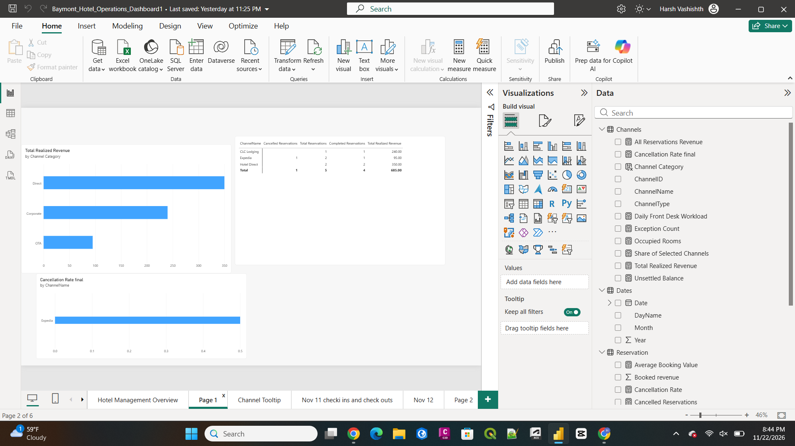
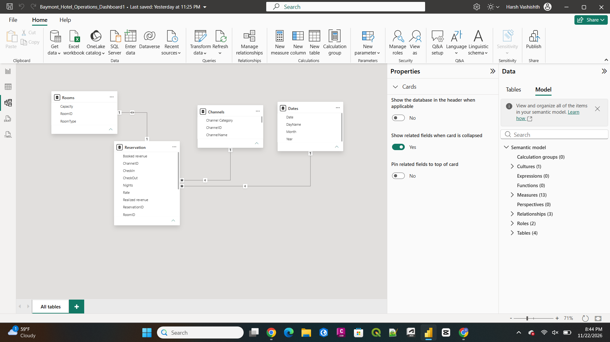

# Baymont Hotel — Operations Dashboard (`Hotel Management Overview`)

An end-to-end **Power BI Business Intelligence & Hospitality Analytics** project modeled on **Baymont Inn** front-desk and night-audit operations[cite: 2]. This repository documents the primary executive report page (**`Hotel Management Overview`**)[cite: 2, 8], showcasing realized revenue, reservation conversion, cancellation monitoring, channel performance, and room-type yield on a Star Schema data model[cite: 2, 6, 7, 8].

---

## Dashboard Preview & Visual Showcase

### 1. Primary Executive View — `Hotel Management Overview`
[cite: 8]

* **What it shows:** The primary **`Hotel Management Overview`** canvas featuring six KPI cards (**Total Realized Revenue**, **Total Reservations**, **Completed Reservations**, **Cancelled Reservations**, **Cancellation Rate**, and **Average Booking Value**), dropdown slicers for **Date** (`Dates[Date]`) and **ChannelName** (`Channels[ChannelName]`), and two horizontal bar charts comparing **Total Realized Revenue** across booking channels (**Hotel Direct**, **CLC Lodging**, **Expedia**) and room types (**King**, **Suite**, **Double Queen**)[cite: 2, 8].

### 2. Channel Performance & Cancellation Breakdown
[cite: 6]

* **What it shows:** A supporting channel view from the workbook displaying **Total Realized Revenue by Channel Category**, a table breaking down reservation counts and realized revenue by channel, and a **Cancellation Rate final by ChannelName** chart—providing additional channel context alongside the **`Hotel Management Overview`** page[cite: 2, 6, 8].

### 3. Semantic Model & Table Relationships
[cite: 7]

* **What it shows:** The Power BI **Model view** (`All tables`) illustrating the central **`Reservation`** fact table connected via one-to-many (`1:*`) relationships to **`Rooms`** (`RoomID`), **`Channels`** (`ChannelID`), and **`Dates`** (`Date`), alongside the semantic model summary (**13 measures**, **4 tables**, **3 relationships**, and **2 security roles**)[cite: 2, 7].

---

## Business Context & Operational Objectives

Hospitality front-office and night-audit teams track daily reservation velocity, realized revenue vs. cancellations, and booking channel mix (Direct vs. OTA vs. Corporate/Lodging accounts) to protect property yield and room availability[cite: 2, 8].

The **`Hotel Management Overview`** page answers four core operational questions for property leadership[cite: 2, 8]:
1. **Revenue & Booking Yield:** How much realized revenue is generated from completed stays, and what is the average value per completed booking[cite: 2, 8]?
2. **Reservation Conversion vs. Attrition:** How many total reservations convert to completed stays versus cancellations, and what is the overall cancellation rate[cite: 2, 8]?
3. **Channel Performance:** Which booking channels (**Hotel Direct**, **CLC Lodging**, **Expedia**) drive the highest realized revenue[cite: 2, 8]?
4. **Room Inventory Mix:** How does realized revenue distribute across room categories (**King**, **Suite**, **Double Queen**)[cite: 2, 8]?

---

## Dashboard Architecture (`Hotel Management Overview`)

The primary **`Hotel Management Overview`** page is organized into three functional zones[cite: 2, 8]:

### 1. Executive KPI Cards (Top & Middle Grid)
Six KPI cards summarize core property performance dynamically across active filters[cite: 2, 8]:
* **Total Realized Revenue** — Sum of realized revenue across completed stays[cite: 2, 8].
* **Total Reservations** — Distinct count of all reservation records (`ReservationID`)[cite: 2, 8].
* **Completed Reservations** — Distinct count of reservations with `"Completed"` status[cite: 2, 8].
* **Cancelled Reservations** — Distinct count of reservations with `"Cancelled"` status[cite: 2, 8].
* **Cancellation Rate** — Share of cancelled reservations relative to total reservations (`%`)[cite: 2, 8].
* **Average Booking Value** — Mean realized revenue per completed reservation (`$`)[cite: 2, 8].

### 2. Interactive Slicers (Right Control Panel)
* **Date Dropdown Slicer (`Dates[Date]`)** — Filters KPI cards and bar charts by date[cite: 2, 8].
* **Channel Dropdown Slicer (`Channels[ChannelName]`)** — Isolates performance for individual booking channels (`Hotel Direct`, `CLC Lodging`, `Expedia`)[cite: 2, 8].

### 3. Comparative Performance Visuals (Bottom Row)
* **Total Realized Revenue by Channel (`Clustered Bar Chart`)** — Ranks booking channels descending by realized revenue (`Channels[ChannelName]`)[cite: 2, 8].
* **Total Realized Revenue by Room Type (`Clustered Bar Chart`)** — Ranks room categories descending by realized revenue (`Rooms[RoomType]`)[cite: 2, 8].

---

## Star Schema Data Model

The semantic model links three dimension tables (`Rooms`, `Channels`, `Dates`) to the `Reservation` fact table via one-to-many relationships[cite: 2, 7]:

```text
               +-----------------+
               |     Rooms       |
               |-----------------|
               | RoomID (PK)     |
               | Capacity        |
               | RoomType        |
               +--------+--------+
                        | 1
                        |
                        | *
+--------------+  1   * +------------------------+  *   1  +-----------------+
|   Channels   +------->|      Reservation       |<--------+      Dates      |
|--------------|        |------------------------|         |-----------------|
| ChannelID(PK)|        | ReservationID          |         | Date (PK)       |
| ChannelName  |        | RoomID (FK)            |         | DayName / Month |
| ChannelCat.  |        | ChannelID (FK)         |         | Year            |
| ChannelType  |        | CheckIn / CheckOut     |         +-----------------+
+--------------+        | Nights / Rate          |
                        | Status                 |
                        | Realized revenue       |
                        | Booked revenue         |
                        +------------------------+
```[cite: 2, 7]

---

## DAX Measure Glossary (Page 1 Metrics)

Key measures driving the **`Hotel Management Overview`** cards and charts include[cite: 2, 8]:

```dax
// 1. Total Realized Revenue
Total Realized Revenue = 
SUM('Reservation'[Realized revenue])

// 2. Total Reservations
Total Reservations = 
DISTINCTCOUNT('Reservation'[ReservationID])

// 3. Completed Reservations
Completed Reservations = 
CALCULATE(
    DISTINCTCOUNT('Reservation'[ReservationID]),
    'Reservation'[Status] = "Completed"
)

// 4. Cancelled Reservations
Cancelled Reservations = 
CALCULATE(
    DISTINCTCOUNT('Reservation'[ReservationID]),
    'Reservation'[Status] = "Cancelled"
)

// 5. Cancellation Rate
Cancellation Rate = 
DIVIDE(
    [Cancelled Reservations],
    [Total Reservations],
    0
)

// 6. Average Booking Value
Average Booking Value = 
DIVIDE(
    [Total Realized Revenue],
    [Completed Reservations],
    0
)
```[cite: 2, 8]

---

## Data Privacy & Synthetic Dataset Disclaimer

* **100% Synthetic Hospitality Data:** All reservation IDs, room rates, stay dates, channel figures, and operational records in this project are **synthetically generated** for Business Intelligence modeling and portfolio demonstration[cite: 2].
* **Zero PII / PCI Exposure:** No real guest names, payment card numbers, folio details, or proprietary hotel PMS records are included in this repository or `.pbix` file[cite: 2].

---

## Repository Structure

```text
├── Baymont_Hotel_Operations_Dashboard1.pbix   # Power BI Desktop report & Star Schema model
├── Hotel Management Overview.jpg              # Primary Hotel Management Overview screenshot
├── Channel_Performance.jpg                    # Channel performance & cancellation view
├── Channels_Relationships.jpg                 # Star Schema model & relationships view
└── README.md                                  # Project documentation & DAX reference
```[cite: 2, 6, 7, 8]

---

## Author

**Harsh Vashishth**[cite: 2]  
GIS, Remote Sensing & Business Intelligence Analyst  
GitHub: [@harshvashishth-gis-developer](https://github.com/harshvashishth-gis-developer)
